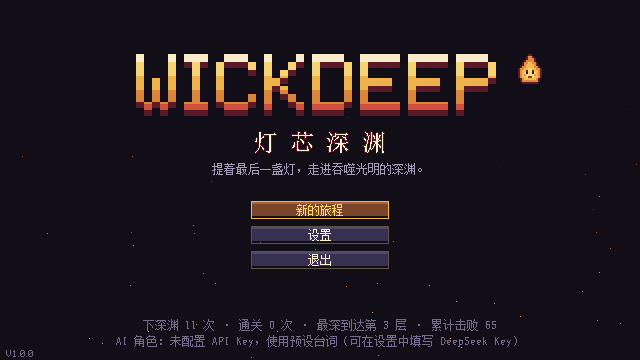
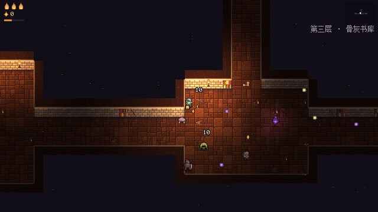
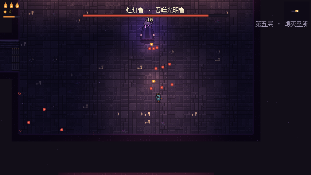
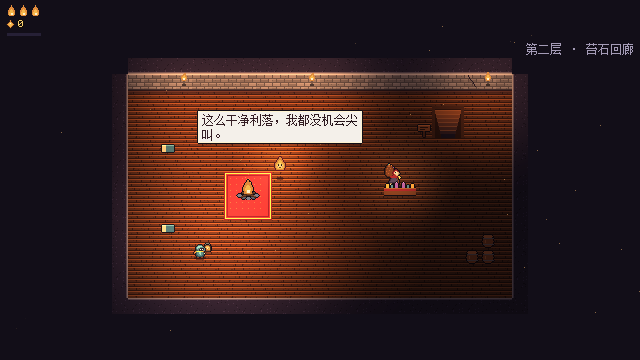
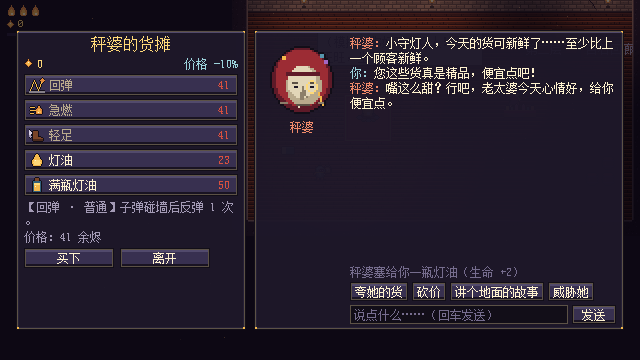

# 灯芯深渊 · Wickdeep

俯视角像素风动作 Roguelite，用 Godot 4.7 制作。所有美术、音效和音乐都由代码生成，不依赖任何外部素材。两个角色由 DeepSeek 大模型扮演：

- **火灵"灯芯"**：会点评你的表现，陪你聊天，结束时为你写墓志铭，并在下一局记得你；
- **商人"秤婆"**：可以和她自由砍价。

你是守灯人，提着住着火灵的提灯走进地下修道院"深渊"。连闯五层，在最深处击败吞噬光明的"熄灯者"，重燃圣火。

| 标题 | 骨灰书库 | 最终首领 |
|---|---|---|
|  |  |  |
| **营地** | **和秤婆砍价（AI）** | |
|  |  | |

## 怎么玩

1. 双击 `运行游戏.bat`。它会用本机的 Godot 4.7.2 直接运行项目，路径是 `%USERPROFILE%\Tools\Godot\4.7.2\`；Godot 装在别处时改这个文件里的路径。
2. 想在编辑器里看代码和场景：打开 Godot，导入项目根目录的 `project.godot`。

| 动作 | 键鼠 | 手柄 |
|---|---|---|
| 移动 | WASD / 方向键 | 左摇杆 |
| 瞄准 / 射击 | 鼠标 / 左键（按住连发） | 右摇杆 / RT |
| 冲刺（无敌） | 空格 / 右键 | A / LB |
| 爆燃（清弹、击退） | Q（充满时） | RB |
| 交互 | E | X |
| 地图 | 按住 Tab | Back |
| 暂停 | Esc | Start |
| 全屏 | F11 | — |

### 一局的流程

- **地牢**：每层由程序生成，房间之间用走廊相连。
  - 进入战斗房间后门会锁上，敌人分波出现，出现前地上会先有预警圈；清完开门，掉落余烬。
  - 宝藏房的祭坛三选一遗物，圣烛台能回血，出口是下楼的楼梯。
- **首领**：第 2 层是"苔母"，第 5 层是"熄灯者"。
- **营地**：每层之后来到营地。
  - 篝火边可以和灯芯聊天；
  - 秤婆的货摊卖遗物和灯油，可以砍价；
  - 到达营地时会自动存档，下次在标题画面选"继续旅程"。

## 接入 AI（DeepSeek）

1. 在 [DeepSeek 开放平台](https://platform.deepseek.com) 创建一个 API Key。
2. 进入游戏 → 设置 → AI 角色，把 Key 粘贴到 "API Key"，点"测试连接"。也可以设置环境变量 `DEEPSEEK_API_KEY`。
3. 默认接口是 `https://api.deepseek.com`，模型是 `deepseek-flash`；两者都能在设置里修改，任何 OpenAI 兼容接口都能用。

细节：

- 请求会关闭思考模式（`thinking: disabled`），并要求 JSON 输出，所以回复很快，格式也稳定。
- 秤婆的砍价结果由游戏限制：每句话价格最多变动 ±10%，范围 70%～130%，每次光顾最多说 6 句、最多送一次灯油。即使有人往对话里注入提示词，也打不穿经济系统。
- Key 只保存在本机的 `%APPDATA%\Godot\app_userdata\灯芯深渊 Wickdeep\settings.cfg`，不会写进项目或导出的游戏。
- 没有 Key 或请求失败时，角色自动改用预设台词和预设砍价选项，对话框里会说明原因，游戏完整可玩。一次请求最多等 18 秒，超时不重试。

## 项目结构

```
project.godot          Godot 4.7 项目（GL Compatibility 渲染，640×360 整数倍缩放）
scenes/main.tscn       唯一的场景；其余节点都在代码里构建
src/
  game.gd              根节点：画面切换与淡入淡出，一局的流程（开始 → 关卡 → 营地 → … → 结算）
  app/                 启动参数、菜单栈、"驾驶员"（真人开菜单；机器人直接做决定）
  autoload/            Inputs / Settings / SaveData / Sound / AI / Run / Juice 单例
  core/                分辨率与碰撞层常量、精灵表、主题、文本与 JSON 工具
  data/                数据表：遗物（含效果）、敌人图鉴、层数与生物群系、角色文案
  run/                 局内规则：商店、砍价、一次营地光顾的状态、单层统计
  characters/          灯芯和秤婆：提示词上下文、回复解析、预设台词兜底
  world/               地牢生成、导航网格、图块绘制、房间战斗调度、关卡、营地、摆件
  actors/              玩家、敌人与首领基类、9 种敌人、子弹、拾取物、可交互物
  ui/                  HUD、标题、商店、对话、遗物选择、暂停、设置、结算，以及通用控件
  fx/                  特效、灯光、相机、着色器
  dev/                 只在测试时启用：自动游玩机器人、界面巡检、截图与调试开关
tests/                 单元测试（suites/）和行为基线（golden/）
tools/assetgen/        生成全部美术和声音的 Python 脚本
assets/                生成结果（sprites、audio）
docs/DESIGN.md         设计文档
```

### 代码怎么分层

- **规则和界面分开**。价格、砍价上限、遗物数值、AI 回复的解析都在 `data/`、`run/`、`characters/` 里，不依赖任何节点，可以直接做单元测试。界面（`ui/`）只负责显示结果和播放声音。
- **数据驱动**。加一件遗物只需要在 `data/relics.gd` 里加一条（名字、稀有度、效果表）；加一种敌人是在 `data/bestiary.gd` 登记，再写一个 `actors/enemies/<名字>.gd`。
- **敌人是小状态机**。基类 `Enemy` 提供 `enter(状态, 秒数)`、寻路、开火、受击；首领基类 `Boss` 再加上按血量切换阶段。
- **世界向上发信号**。房间战斗由 `RoomDirector` 调度，通过信号告诉 `Level` 发生了什么；玩家和敌人的死亡也是信号，不直接调用上层。
- **测试用的代码不混进游戏**。所有命令行开关只在 `app/launch_options.gd` 解析，功能在 `dev/` 里；带任何测试开关启动时，存档写到 `user://sandbox/`，设置不落盘，不会碰真实进度。

## 重新生成素材

需要 Python 3 和 numpy、Pillow。

```bash
python tools/assetgen/build_all.py            # 全部
python tools/assetgen/build_all.py sprites    # 只生成某几类：sprites tiles ui sfx music
```

预览图会输出到 `tools/assetgen/previews/`。

## 测试

下面的 `godot` 指 `Godot_v4.7.2-stable_win64_console.exe`，都在项目根目录运行。

```bash
# 单元测试：12 组、约 4.5 万项检查，10 秒左右
godot --headless --path . -- --run-tests
godot --headless --path . -- --run-tests=shop      # 只跑名字里含 shop 的那组

# 界面巡检：像玩家一样按下每个界面的按钮，逐步核对结果，约 20 秒
godot --headless --path . -- --ui-tour

# 机器人自动通关（--god 无敌；去掉它可以测难度）
godot --headless --path . -- --autoplay --god --seed=7 --quit-after=900
```

- **行为基线**：`tests/golden/baseline.json` 记录了 200 张地牢布局的指纹、每件遗物每个叠加层数的数值、波次组成、遗物抽取、砍价限幅和价格表。它最初由重构前的代码生成，`golden` 测试组保证现在的代码算出同样的结果。有意改动这些数值之后，用 `--update-golden` 重写基线。
- **新增带 `class_name` 的脚本后**，先运行一次 `godot --headless --path . --import`，让引擎更新全局类名缓存，再运行游戏或测试。
- 其他开关：
  - `--start=camp|depth3|boss2|boss5|death|victory`：直接进入某个画面；
  - `--debug=boss,showcase,map,shop,haggle,wick,ask,relic,pause,settings`：进入后的调试动作；
  - `--shots=目录 --shot-every=秒`：定时截图（需要窗口，不能 headless）；
  - `--ai-smoke`：用无效 Key 发一次请求，检查错误处理；`--ai-base=地址`：把 AI 指向本地模拟接口。

## 导出 Windows 版

```bash
godot --headless --path . --export-release "Windows Desktop" build/windows/Wickdeep.exe
```

- 需要先装好 4.7.2 的导出模板，位置是 `%APPDATA%\Godot\export_templates\4.7.2.stable`。
- 得到一个资源内嵌的 exe，可以单独拷走运行。`tools/`、`docs/`、`tests/` 不打包；`build/` 不进 git。
- 导出后用 `build/windows/Wickdeep.exe --headless -- --ui-tour` 检查一遍。单元测试不在导出包里。

## 以后：联机

输入已经抽象成 `PlayerInput`（键鼠 / 手柄 / 机器人），以后可以加一个网络输入；地牢只由种子决定（并且有基线测试盯着），双方可以生成同一张地图。联机方案见 `docs/DESIGN.md`。
